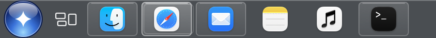
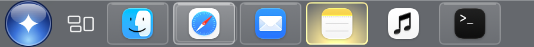

# Superbar

A taskbar for macOS 26 that works like the one in Windows 7: a Start button, app buttons with live window previews, a system tray, a clock, and a show desktop strip.





More at [superbar.cc](https://superbar.cc).

## What it does

- **App buttons** for running and pinned apps. Click to switch, click the active app to minimize it, and right-click for its windows and actions.
- **Window previews** when you hover a button. Close a window from its preview.
- **Start menu** (⌃⎋) to search and open apps, reach common folders, and sleep, restart, or shut down.
- **System tray** with Trash, Wi-Fi, sound, battery, and a calendar under the clock.
- **Show desktop** at the far right, from a full-screen app too.
- **Window snapping** with ⌃⌥ shortcuts: fill, halves, quarters, and thirds, always above the bar.
- **Always show, auto-hide, or always hide**, with your own hide delay.
- **Hides the Dock** if you want it to, and puts it back exactly as it was.

## Build and install

You need macOS 26 or later and either Xcode or the Command Line Tools (`xcode-select --install`).

```bash
git clone https://github.com/iMahesh/superbar.git
```

```bash
cd superbar && ./build.sh --open
```

`build.sh` builds a release copy, installs it to `~/Applications/Superbar.app`, and opens it. It signs with your Apple Development certificate if you have one, and ad hoc otherwise, which is fine for your own Mac. An app you build yourself opens without a Gatekeeper warning.

## Permissions

Superbar asks for these in its Settings, under Permissions:

- **Accessibility** to list, switch, minimize, and snap windows. Required.
- **Screen Recording** for live window previews. Without it, previews show the app icon.
- **Automation of System Events** to restart, shut down, or log out the way the Apple menu does, so apps can ask you to save your work.

macOS ties these to the app's signature. With an ad hoc signature, every rebuild counts as a new app, so you have to turn Accessibility and Screen Recording off and on again after each build.

## Private APIs

Some features use private macOS calls, the same ones window tools like AltTab and yabai use: bringing one window to the front, finding windows on other Spaces, telling a full-screen Space apart, and show desktop. They are looked up when Superbar starts, and each one has a fallback if a future macOS drops it. This is also why Superbar can't be on the Mac App Store.

## Development

```bash
tools/test.sh
```

```bash
tools/selftest.sh
```

`tools/test.sh` runs the unit tests for SuperbarKit, the logic that doesn't need a screen. `tools/selftest.sh` launches the app and checks it end to end. `docs/` has the spec, the user stories, and a log of past bugs and their causes.

## License

Superbar is source-available under the [PolyForm Noncommercial License 1.0.0](LICENSE.md). You can build it, use it, change it, and share it for any noncommercial purpose. Selling it or using it commercially needs a separate license from the author.

This is not an open source license. Pull requests are welcome, but you'll be asked to agree to a contributor license agreement, so the project can keep its licensing options.
